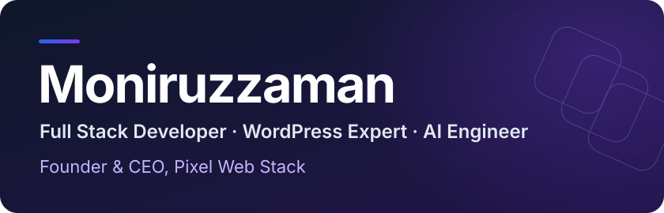

<h1 align="center"></h1>

I build websites, online stores, and custom web apps for businesses and agencies. With 7+ years in web development, I help teams connect their tools, automate repeatable tasks, and make it easier for customers to take the next step.

<a href="https://pixelwebstack.com/"><strong>Pixel Web Stack</strong></a> &nbsp;·&nbsp; <a href="https://mdmonir.net/">Personal portfolio</a> &nbsp;·&nbsp; <a href="https://linkedin.com/in/heymonir/">LinkedIn</a>

## What I build

**AI-powered websites and business workflows**  
I integrate assistants and AI agents into websites and apps to handle tasks like answering common questions and triaging inquiries. I connect forms, CRMs, and other tools through APIs, with human review and clear handoffs where they matter.

**Custom web applications**  
I build responsive interfaces, backends, and integrations that bring the tools and data your team uses into a single workflow.

**WordPress websites and WooCommerce stores**  
I build and customize sites with attention to speed, responsive design, and technical SEO so people can find what they need on any device.

## Technical expertise

- **Full stack** · React, Next.js, TypeScript, JavaScript, Node.js, MongoDB
- **WordPress** · Divi 5, Elementor, Bricks, WooCommerce
- **AI and integration** · AI agents, workflow automation, APIs, CRM integrations

## Selected projects

**[WPOS](https://wpos.be/)** · Pixel Web Stack built this WordPress and Divi 5 site for a Belgian point-of-sale provider. Navigation is organized around hardware, software, and the industries it serves.

**[Prokit Boutique](https://prokitboutique.com/)** · Pixel Web Stack built this responsive football jersey store with Elementor and WooCommerce.

**[Personal portfolio source](https://github.com/heymonir/A01-DevConf)** · A Next.js, React, and TypeScript site with project and service directories, a journal, and a contact form.

**WordPress utilities** · [Divi 5 child theme](https://github.com/heymonir/Divi-5-Child-Theme), [Divi mobile submenus](https://github.com/heymonir/Collapse-Divi-Mobile-Menu-Submenus), and [WooCommerce quantity controls](https://github.com/heymonir/WooCommerce-quantity-minus-plus).

[See more Pixel Web Stack projects](https://pixelwebstack.com/projects/)

## Let’s work together

Planning a website, app, or automation? Tell me what you’re building or which workflow takes up too much time.

**[Discuss your project](https://pixelwebstack.com/contact/)** · [Connect on LinkedIn](https://linkedin.com/in/heymonir/)
